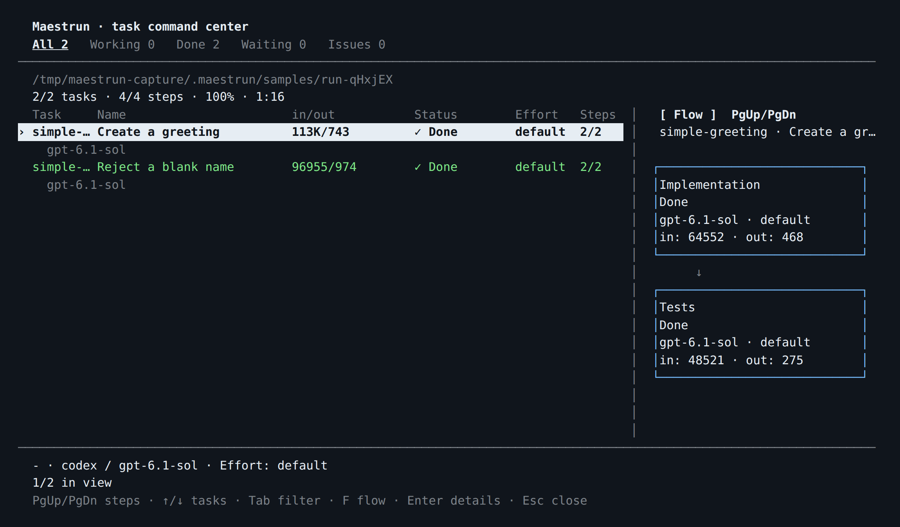
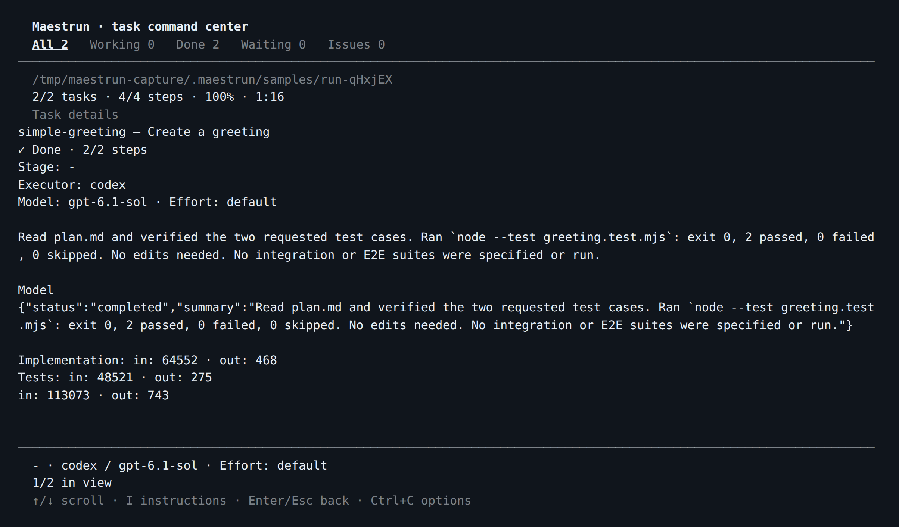

# Maestrun — advanced guide

[← Simple guide](../README.md)

Use this reference when you need more control. Run `maestrun <command> --help` for command options.

- [Workflow and configuration](#workflow-and-configuration)
- [Templates](#templates)
- [Planning and task format](#planning-and-task-format)
- [Execution and recovery](#execution-and-recovery)
- [Terminal and layout](#terminal-and-layout)
- [Extensions and host plugins](#extensions-and-host-plugins)
- [Files and version control](#files-and-version-control)
- [Sample](#sample)
- [Development and releases](#development-and-releases)

## Workflow and configuration

`maestrun init --advanced` opens the full editor: stages, per-stage executor/model/effort, frontend/backend assignments, and sequential or parallel execution. Esc goes back; Ctrl+C cancels.

Planning is always first. Custom stages use `custom:<name>` and optional `.maestrun/steps/<name>.md` instructions. Existing QA/Review stages remain supported; add them to new workflows through global presets.

`config.json` → `stages` lists model-executed stages. **Integration** is an automatic Git operation for worktree tasks, so it does not belong in `stages` and has no executor, model or effort setting. It integrates task changes into the main project after the configured stages pass; the task is complete only after integration succeeds. The flowchart shows both configured task stages and this automatic operation.

Use exact model IDs. Manual entry is available if discovery fails; Claude aliases and Copilot `auto` are not accepted. Model discovery does not guarantee account access. Unset effort uses the executor's default; Grok may ignore unsupported effort settings.

### Edit settings

```sh
maestrun config                            # effective project settings
maestrun config execution parallel
maestrun config concurrency 4
maestrun config execution.maxRepairs 5
maestrun config stages planning model your-model-id
maestrun config stages planning effort high
maestrun config timeoutMs 600000
maestrun config global background true     # default for other projects
maestrun config stages.planning.effort null # remove an optional override
```

Changes save immediately. Paths accept spaces or dots, stage IDs or zero-based indexes. Use spaced paths for IDs containing dots: `stages 'custom:Audit.v2' effort high`. JSON can replace entire sections. Invalid changes preserve the file.

| Setting                 | Default / constraint                                                |
| ----------------------- | ------------------------------------------------------------------- |
| `execution.mode`        | `sequential` or `parallel`                                          |
| `execution.concurrency` | 1–16; defaults to 2 when omitted; sequential runs one task          |
| `execution.maxRepairs`  | 5 repair cycles per task per run; integer 0–100; 0 disables repairs |
| `execution.background`  | `false`                                                             |
| `timeoutMs`             | 600000; range 1000–86400000, per executor invocation                |
| Stage `effort`          | Executor default when unset                                         |
| `targets`               | Optional; requires both frontend and backend assignments            |
| `plugins`               | Empty; project-relative `./…mjs` or `./…js` modules                 |

Frontend/backend overrides affect only Implementation for tasks with that target. Other stages keep their assignments.

### Global defaults and presets

Global settings live in `~/.maestrun/config.json`; project settings live in `.maestrun/config.json`. Project values win. Execution fields merge individually; stages, targets, and plugin arrays replace the global section. Paths remain relative to the project using them.

Execution, timeout, plugins, and presets can be configured globally before setup. Editing an unset global stage/target section copies it from the current project, or you can supply the whole section as JSON. Projects may inherit global stages without a local workflow.

```sh
maestrun config global stepPresets '["QA", "Review", {"name":"Security audit","effort":"high"}]'
maestrun config global stepPresets 'Security audit' model your-model-id
```

Presets appear unchecked in the full workflow picker. Names are unique ignoring case. Saved project assignments win; a shared assignment overrides presets for the selected steps. Preset changes affect future setup, not existing workflows. Use `null` to remove optional fields or the list.

### Configuration example

Replace the model placeholders with IDs available to your account:

```json
{
  "version": 1,
  "stages": [
    { "id": "planning", "executor": "codex", "model": "your-model" },
    { "id": "implementation", "executor": "codex", "model": "your-model" },
    { "id": "testing", "executor": "claude", "model": "your-claude-model" }
  ],
  "execution": { "mode": "parallel", "concurrency": 2, "background": false },
  "timeoutMs": 600000,
  "plugins": []
}
```

## Templates

Reuse a workflow locally:

```sh
maestrun template save team
cd /path/to/another/project
maestrun init --template
```

Transfer it to another machine:

```sh
maestrun template export team.json
# Copy team.json to the destination machine.
maestrun template import team.json team
maestrun init --template
maestrun doctor
```

- Packages contain configuration, referenced step instructions, and extension requirements.
- Missing files are listed. Identical instructions are preserved; conflicting files stop initialization.
- Plugin code and dependencies must be copied separately. Import never authorizes execution.
- Save/import and project replacement require confirmation. Legacy configuration-only templates still work.

Templates live in `~/.maestrun/templates/<name>.json`. Names use 1–64 letters, digits, hyphens, or underscores, starting with a letter or digit.

## Planning and task format

### Create a plan separately

```sh
maestrun init
maestrun plan                 # collect requirements and generate
maestrun plan --interactive   # also allow model clarification questions
maestrun run --dry-run
```

Both planning modes require a terminal and run environment checks first. Existing planning documents appear in the requirements selector; you can also enter another path. Choose **Simple** for one plan or **Advanced** for `prd.md`, `techspec.md`, and `tasks.md` in a new folder. Root `plan.md` links to the generated tasks.

Planning includes project guidance automatically: skills under `.agents`, `.codex`, `.claude`, and `.github`; rules under their rule/instruction folders; root `AGENTS.md`, `CLAUDE.md`, and `.github/copilot-instructions.md`. The preview lists loaded files. Replacing a plan requires confirmation; failed or cancelled generation preserves the previous plan.

Planning restricts tools to reading. These restrictions are not a universal OS sandbox; executor policies still apply. Interactive Codex uses one planning session, with its timeout including answer time. Claude, Copilot, and Grok apply the timeout per request.

### Write tasks

Use this format in `plan.md` or pass another file with `--tasks`:

```markdown
## Tasks

### Task api: Implement the API

- Depends on: none
- Target: backend

Implement the endpoint described in the specification.

#### Acceptance criteria

- [ ] Reject invalid input.
- [ ] Cover valid requests with tests.

#### Verification

Run the API tests and record the results.

### Task ui: Connect the UI

- Depends on: api
- Target: frontend

Connect the UI and test loading, success, and error states.
```

IDs must be unique letters, digits, underscores, or hyphens. Dependencies are `none` or comma-separated IDs. Target is optional. Each task needs nonempty instructions; use level-4 headings inside it. Missing dependencies and cycles fail validation. Checkboxes do not determine completion: saved progress does.

For one file per task, make `tasks.md` a checklist of Markdown links. Each linked file starts with `# Task <id>: <title>`, followed by the same metadata and instructions. Paths are relative to the index; wrap paths containing spaces in `<...>`. Checked links are still loaded.

```sh
maestrun run --tasks tasks/tasks.md --dry-run
maestrun run --tasks tasks/tasks.md
```

Legacy JSON task files and fenced `maestrun-tasks` blocks remain supported. Do not mix JSON blocks and Markdown tasks in one document.

## Execution and recovery

### Run, detach, reconnect

| Command                        | Behavior                                                                             |
| ------------------------------ | ------------------------------------------------------------------------------------ |
| `maestrun start`               | Check environment; reuse or create workflow/plan; preview; ask to run                |
| `maestrun run`                 | Start/resume tasks, or reconnect to an active worker                                 |
| `maestrun run --dry-run`       | Validate tasks and checkpoints without model calls, plugin imports, or report writes |
| `maestrun run --background`    | Start a background worker                                                            |
| `maestrun run --no-background` | Override the saved background preference for this run                                |
| `maestrun`                     | Reconnect to an active or saved background session                                   |
| `maestrun run --status`        | Print the saved report as JSON                                                       |

`start` also accepts `--tasks`, background options, and `--trust-plugins`. An invalid existing plan stops the command instead of being regenerated. `run` and `--status` work without a terminal.

Every task runs the configured stages after Planning. Completed tasks and steps are skipped. Parallel execution uses bounded batches with a separate Git worktree for each task. Dependent tasks start only after their prerequisites are integrated.

Model-reported failure/refactor gets **up to 5 automatic repair cycles per task per run**, restarting at Implementation when possible. Set `execution.maxRepairs` to change the limit; `0` disables repairs. Exhausting the limit blocks dependants; independent tasks can continue. Executor errors, invalid output, timeouts, and cancellation stop that task immediately. Repair evidence is retained in the report.

Executors can edit the workspace and run checks; prompts prohibit commits, pushes, and deployment. Success is the executor's reported result. Local server checks should start the server and test it in the same shell command, especially under Linux/WSL sandboxing.

### Parallel worktrees

Parallel mode requires **Git 2.38+**, an initial commit, and execution from the repository root. Unresolved merges and submodules must use sequential mode. `doctor` and dry-run check these prerequisites.

- Each task gets a snapshot of tracked and nonignored files, including uncommitted changes. Runtime state is excluded; configuration and step instructions are copied separately.
- Worktrees live under `~/.maestrun/worktrees/<project-id>/`. Ignored dependencies and environment files are not copied; install dependencies inside each worktree.
- After the task's stages pass, a [three-way Git merge](https://git-scm.com/docs/git-merge-tree) integrates its changes. The main branch and staging index are preserved; snapshots create internal Git objects, not branch commits.
- Conflicts leave the main project untouched by that integration. The original output is retained, and a separate resolution worktree contains conflict markers. Resolve and test there, run `git add` for resolved files, then repeat the original Maestrun command **from the main project**. Completed stages are not rerun during integration-only recovery.
- Failed/cancelled worktrees are kept for resume. Successful integration removes the task's worktrees. Keep `.maestrun/run.json` and retained worktrees together until recovery finishes.

Worktrees isolate files, not network ports, databases, or plugin process memory. Use task-specific resources or explicit dependencies. Extensions must use the supplied `cwd`. Older partial checkpoints without worktrees should finish in sequential mode before enabling parallel execution.

### Recover from a failure

Interactive failures offer **View evidence**, **Adjust configuration**, **Resume**, and **Exit and keep progress**. Resume validates the same task document and keeps the current invocation's plugin authorization. Noninteractive failures print next steps and exit.

| Problem                        | Next step                                                                                                    |
| ------------------------------ | ------------------------------------------------------------------------------------------------------------ |
| Installation or authentication | Run `maestrun doctor`; follow the executor's login/update instructions                                       |
| Unavailable model              | Choose an accessible exact ID with `maestrun init --advanced`                                                |
| Invalid plan                   | Fix the task document, then run `maestrun run --dry-run`                                                     |
| Failed task                    | Inspect `maestrun run --status`, fix the cause, and repeat the same run command                              |
| Timeout                        | Check connectivity/account limits or increase `timeoutMs`                                                    |
| Missing template file          | Copy it into the project or remove its stage/plugin reference                                                |
| Stale lock after a crash       | Confirm the worker and executors stopped before removing stale `session.json`, `session.lock`, or `run.lock` |

**Preserve `.maestrun/run.json`.** Changed task definitions or incompatible stage sequences stop resume; use new task IDs for different work. Interrupted steps may run again, so inspect partial changes first. Tasks removed from the current plan retain their progress in `archivedTasks`.

Doctor checks Node/platform, executor compatibility/authentication, config/layout, referenced files, and locks without generation or plugin execution. Missing unused executors are warnings; unusable configured executors and execution locks are errors. It never deletes locks. Exit codes: **0** success/detachment, **1** failure, **130** cancellation.

## Terminal and layout

| Key                     | Action                                                            |
| ----------------------- | ----------------------------------------------------------------- |
| ↑ / ↓                   | Select task or scroll details                                     |
| Tab / Shift+Tab, ← / →  | Change status filter                                              |
| Enter                   | Toggle task details                                               |
| F                       | Toggle flowchart                                                  |
| PgUp / PgDn, Home / End | Browse steps or jump to first/last                                |
| I                       | Send instructions to a running model task                         |
| Esc                     | Leave details/input; close a finished run                         |
| Ctrl+C                  | Choose background execution or cancellation; plain output cancels |

Codex steers the active turn; Claude, Copilot, and Grok queue follow-ups in the same session. Delivery notices and conversations persist across reconnection. Extension steps have no model conversation.

The flowchart labels completed, running, failed, and refactor states. Token counts are input/output for execution only: `n/a` means unavailable, and `*`/`partial` means incomplete data. Counts include repairs and resumes without estimating missing usage.

Set global layout in `~/.maestrun/layout.json` or project overrides in `.maestrun/layout.json`:

```json
{
  "columns": [
    { "id": "task", "width": 10 },
    { "id": "name", "width": "auto" },
    { "id": "status", "width": 14 },
    { "id": "tokens", "width": 16 }
  ],
  "flowchart": { "visible": true, "position": "right", "width": 40, "height": "auto" }
}
```

Column IDs: `task`, `name`, `status`, `stage`, `model`, `effort`, `steps`, `tokens`. Order controls display order; omitted columns are hidden. Use unique IDs and positive widths or `"auto"`.

The flowchart includes every configured task stage and, for worktree tasks, a final **Integration** step labeled **Git · local**. This automatic operation is not an entry in `config.json` → `stages` and makes no model calls. It shows waiting, running, completed, failed or cancelled integration; PgUp/PgDn and Home/End reach every step on smaller terminals.

Flowchart positions: `left`, `right`, `top`, `bottom`. Width is at least 20 cells; height at least 9, or `"auto"`. Side placement needs 97 columns; top/bottom needs 22 rows. Smaller terminals show the chart alone during step browsing.

Project columns replace global columns; flowchart fields merge. Reopen the view after edits. Invalid layout files produce an error without rewriting them; plain logs ignore layout settings.

## Extensions and host plugins

### Runtime extensions

Register a reviewed project-local module and authorize it for each run:

```sh
maestrun config plugins '["./integrations/audit.mjs"]'
maestrun run --trust-plugins
```

Extensions have full process permissions. The flag is never saved or granted by imported configuration; status and dry-run never load extensions. Reconnecting keeps the already-authorized worker.

```js
export default {
  apiVersion: 1,
  name: "audit",
  stages: {
    "custom:Audit": async ({ task, signal }) => {
      signal.throwIfAborted();
      // Perform verification here; throw on failure.
      return `Audit completed for ${task.id}`;
    },
  },
};
```

Optional `beforeStep` and `afterStep` hooks run in configuration order. Hooks/handlers receive `{ cwd, task, stage, signal, timeoutMs }`; `afterStep` also gets `result`. Custom handlers replace that stage's model call and must return a nonempty summary. Built-in stages cannot be replaced; duplicate names/handlers fail validation. Extensions manage their own cancellation, timeouts, and resources, and may be called concurrently.

### Codex and Claude host plugins

Export the bundle into a new directory, then register it with your host:

```sh
maestrun plugin ./maestrun-plugin
claude --plugin-dir ./maestrun-plugin/maestrun
# Or:
codex plugin marketplace add ./maestrun-plugin
codex plugin add maestrun@maestrun-local
```

In Claude, invoke `/maestrun:maestrun`; in Codex, invoke the installed Maestrun skill. The host needs a terminal tool and `maestrun` on PATH. Export only creates files; it does not change global host settings. See the [bundled skill](../plugins/maestrun/skills/maestrun/SKILL.md).

## Files and version control

| Path                                                   | Purpose                                                     |
| ------------------------------------------------------ | ----------------------------------------------------------- |
| `.maestrun/config.json`, `.maestrun/layout.json`       | Project workflow and UI settings                            |
| `.maestrun/steps/*.md`                                 | Custom step instructions                                    |
| `plan.md`                                              | Tasks or links to planning documents                        |
| `<planning-folder>/{prd,techspec,tasks}.md`            | Advanced planning output                                    |
| `.maestrun/run.json`                                   | Completion checkpoints, errors, repair history, token usage |
| `.maestrun/run.log`                                    | Worker diagnostics; replaced on a new run                   |
| `.maestrun/session.json`, `session.lock`, `run.lock`   | Worker state and execution locks                            |
| `.maestrun/background`, `.maestrun/cancel`             | Session control markers                                     |
| `~/.maestrun/worktrees/<project-id>/`                  | Isolated tasks and retained conflict recovery files         |
| `.maestrun/samples/run-*`                              | Independent sample projects                                 |
| `~/.maestrun/config.json`, `layout.json`, `templates/` | Global defaults and reusable workflows                      |
| `~/.maestrun/conversations/<project-id>/`              | Conversations grouped by absolute project path              |

Maestrun creates `.maestrun/.gitignore` when absent. It allows only configuration, layout, step instructions, and the ignore file; other state is ignored by default. Existing ignore rules are preserved. Already-tracked files stay tracked, and secrets must not be placed in allowed files. Older project-local conversations remain readable.

## Sample

```sh
maestrun sample                     # Simple
maestrun sample advanced            # Advanced
maestrun sample advanced --background
```

| Sample                                   | Tasks                            | Scenarios                                                              |
| ---------------------------------------- | -------------------------------- | ---------------------------------------------------------------------- |
| [Simple](../examples/simple/plan.md)     | Greeting → blank-name validation | Sequential implementation/tests, dependency and regression cases       |
| [Advanced](../examples/advanced/plan.md) | Add + clamp → compose results    | Parallel worktrees, automatic QA repair and dependent task integration |

Tasks touch one function and its tests, using only Node.js built-ins. No installs or servers. Simple needs four model stages; advanced normally needs fifteen, including one intentional QA repair. QA deliberately requests a repair to the clamp implementation; the workflow returns to Implementation, repeats Tests and QA, then integrates both independent tasks and runs the dependent task. Actual duration depends on the executor/model.

The advanced sample is expected to complete all three tasks in one run without manual recovery.

Each invocation creates a fresh `.maestrun/samples/run-*` directory and prints its path. Advanced requires Git 2.38+ and automatically creates a separate repository there. In a terminal, choose executor/model/effort; otherwise saved assignments are required. Both use a five-cycle repair limit and exclude plugins, custom steps and target overrides.

To reconnect or resume, enter the printed directory and run `maestrun`. The main project's configuration, Git history and progress stay unchanged. `maestrun sample run` remains available for the original sequential QA demonstration.

### Sample screenshots

These captures show a real `maestrun sample` run using Codex. Timing, token usage, and model output vary between runs.

Both tasks completed, including their Implementation and Tests stages:



Press **Enter** on a task to inspect its result and stage token usage:



## Development and releases

Clone this repository using its clone URL, or extract its source archive:

```sh
git clone https://github.com/maestrun/maestrun.git maestrun-cli
cd maestrun-cli
npm ci
npm run build
npm install --global .
```

| Command                                                                       | Purpose                                                          |
| ----------------------------------------------------------------------------- | ---------------------------------------------------------------- |
| `npm run check`                                                               | Formatting, lint, and TypeScript                                 |
| `npm test`                                                                    | Unit and integration tests with fake executors                   |
| `npm run test:coverage`                                                       | Coverage; minimum 80% for lines, statements, functions, branches |
| `npm run release:pack`                                                        | Checks, tests, build, and compiled `.tgz` package                |
| `npm publish ./maestrun-maestrun-0.1.1-beta.0.tgz --access public --tag beta` | Publish a reviewed Beta package using the owner's npm account    |

Packaging does not publish. Users can install this release with `npm install --global @maestrun/maestrun@0.1.1-beta.0` and update to the newest Beta with `npm install --global @maestrun/maestrun@beta`. Installation checks Node support and Windows/WSL; startup creates the home directory if install scripts were skipped.

Source is grouped into `config`, `contracts`, `shared`, and flat capabilities under `src/modules` (workflow, planning, execution, executors, plugins, onboarding). Each capability exports through `index.ts`; external consumers use the barrel. Shared layers do not depend on capabilities. Architecture tests enforce these boundaries. Builds clear `dist` and exclude tests.

The onboarding target is a ready workflow within five minutes with the environment prepared; it is not yet a measured guarantee. `start` reports setup time, planning reports model wait separately, and `time npm install …` measures installation. No timing telemetry is sent.
