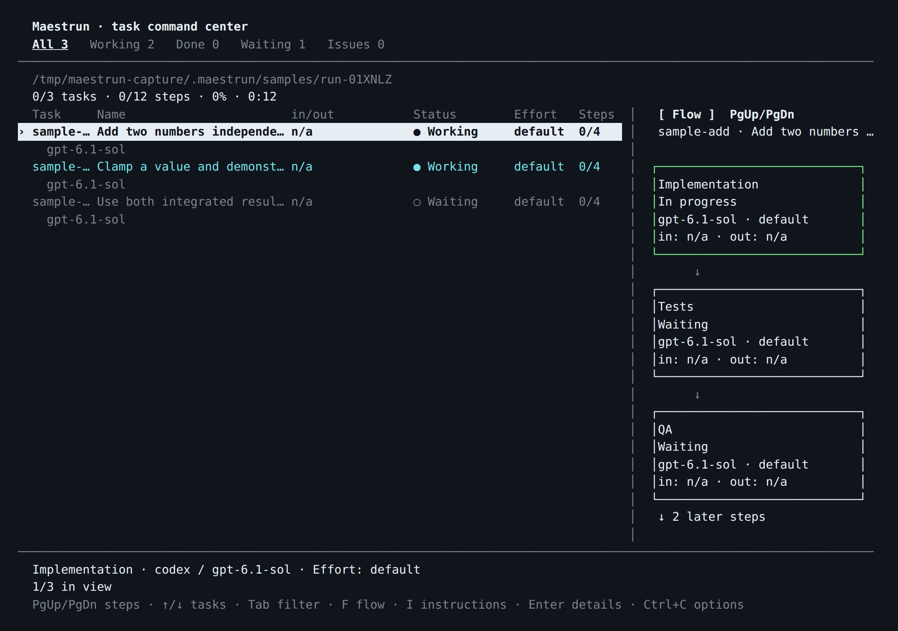
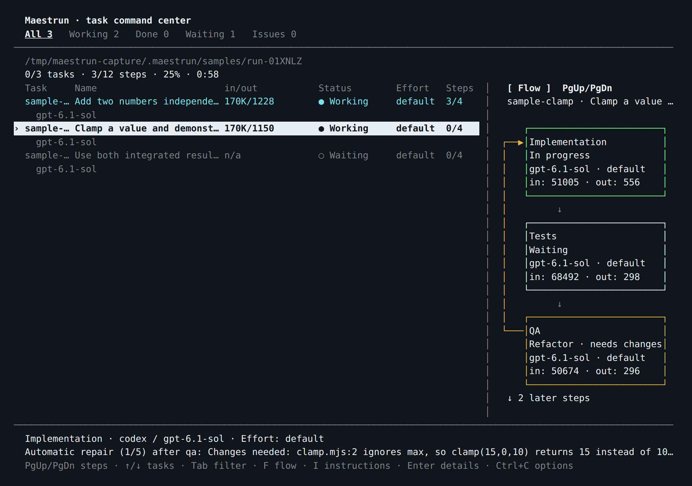
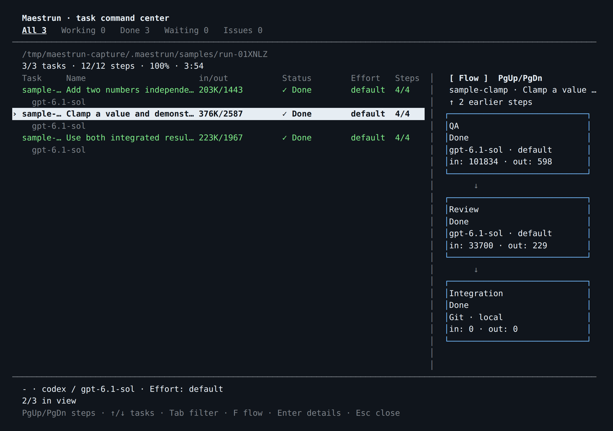

# Maestrun — advanced guide

[← Simple guide](../README.md)

Use this reference when you need more control. Run `maestrun <command> --help` for command options.

- [Workflow and configuration](#workflow-and-configuration)
- [Templates](#templates)
- [Planning and task format](#planning-and-task-format)
- [Orchestrator mode](#orchestrator-mode)
- [Execution and recovery](#execution-and-recovery)
- [Terminal and layout](#terminal-and-layout)
- [Extensions and host plugins](#extensions-and-host-plugins)
- [Files and version control](#files-and-version-control)
- [Sample](#sample)
- [Development and releases](#development-and-releases)

## Workflow and configuration

`maestrun init --advanced` opens the full editor: stages, per-stage executor/model/effort, frontend/backend assignments, and sequential or parallel execution. Esc goes back; Ctrl+C cancels.

Planning is always first. Custom stages use `custom:<name>` and optional `.maestrun/steps/<name>.md` instructions. Existing QA/Review stages remain supported; add them to new workflows through global presets.

`config.json` → `stages` lists model-executed stages. **Integration** is an automatic Git operation for worktree tasks, so it does not belong in `stages` and has no executor, model or effort setting. It integrates task changes into the main project after the configured stages pass; the task is complete only after integration succeeds. The flowchart shows both configured task stages and this automatic operation.

Use exact model IDs. Manual entry is available if discovery fails; Claude aliases and Copilot `auto` are not accepted. Model discovery does not guarantee account access. Unset effort uses the executor's default; Grok may ignore unsupported effort settings.

### Edit settings

```sh
maestrun config                            # effective project settings
maestrun config execution parallel
maestrun config concurrency 4
maestrun config execution.maxRepairs 5
maestrun config stages planning model your-model-id
maestrun config stages planning effort high
maestrun config timeoutMs 600000
maestrun config global background true     # default for other projects
maestrun config stages.planning.effort null # remove an optional override
```

Changes save immediately. Paths accept spaces or dots, stage IDs or zero-based indexes. Use spaced paths for IDs containing dots: `stages 'custom:Audit.v2' effort high`. JSON can replace entire sections. Invalid changes preserve the file.

| Setting                  | Default / constraint                                                                  |
| ------------------------ | ------------------------------------------------------------------------------------- |
| `execution.orchestrator` | `null` (disabled), `plan` (predefined tasks), or `agent` (Planning coordinates tasks) |
| `execution.mode`         | `sequential` or `parallel`                                                            |
| `execution.concurrency`  | 1–16; defaults to 2 when omitted; sequential runs one task                            |
| `execution.maxRepairs`   | 5 repair cycles per task per run; integer 0–100; 0 disables repairs                   |
| `execution.background`   | `false`                                                                               |
| `timeoutMs`              | 600000; range 1000–86400000, per executor invocation                                  |
| Stage `effort`           | Executor default when unset                                                           |
| `targets`                | Optional; requires both frontend and backend assignments                              |
| `plugins`                | Empty; project-relative `./…mjs` or `./…js` modules                                   |

Frontend/backend overrides affect only Implementation for tasks with that target. Other stages keep their assignments.

### Global defaults and presets

Global settings live in `~/.maestrun/config.json`; project settings live in `.maestrun/config.json`. Project values win. Execution fields merge individually; stages, targets, and plugin arrays replace the global section. Paths remain relative to the project using them.

Execution, timeout, plugins, and presets can be configured globally before setup. Editing an unset global stage/target section copies it from the current project, or you can supply the whole section as JSON. Projects may inherit global stages without a local workflow.

```sh
maestrun config global stepPresets '["QA", "Review", {"name":"Security audit","effort":"high"}]'
maestrun config global stepPresets 'Security audit' model your-model-id
```

Presets appear unchecked in the full workflow picker. Names are unique ignoring case. Saved project assignments win; a shared assignment overrides presets for the selected steps. Preset changes affect future setup, not existing workflows. Use `null` to remove optional fields or the list.

### Configuration example

Replace the model placeholders with IDs available to your account:

```json
{
  "version": 1,
  "stages": [
    { "id": "planning", "executor": "codex", "model": "your-model" },
    { "id": "implementation", "executor": "codex", "model": "your-model" },
    { "id": "testing", "executor": "claude", "model": "your-claude-model" }
  ],
  "execution": { "mode": "parallel", "concurrency": 2, "background": false },
  "timeoutMs": 600000,
  "plugins": []
}
```

## Templates

Reuse a workflow locally:

```sh
maestrun template save team
cd /path/to/another/project
maestrun init --template
```

Transfer it to another machine:

```sh
maestrun template export team.json
# Copy team.json to the destination machine.
maestrun template import team.json team
maestrun init --template
maestrun doctor
```

- Packages contain configuration, referenced step instructions, and extension requirements.
- Missing files are listed. Identical instructions are preserved; conflicting files stop initialization.
- Plugin code and dependencies must be copied separately. Import never authorizes execution.
- Save/import and project replacement require confirmation. Legacy configuration-only templates still work.

Templates live in `~/.maestrun/templates/<name>.json`. Names use 1–64 letters, digits, hyphens, or underscores, starting with a letter or digit.

## Planning and task format

### Create a plan separately

```sh
maestrun init
maestrun plan                 # collect requirements and generate
maestrun plan --interactive   # also allow model clarification questions
maestrun run --dry-run
```

Both planning modes require a terminal and run environment checks first. Existing planning documents appear in the requirements selector; you can also enter another path. Choose **Simple** for one plan or **Advanced** for `prd.md`, `techspec.md`, and `tasks.md` in a new folder. Root `plan.md` links to the generated tasks.

Planning includes project guidance automatically: skills under `.agents`, `.codex`, `.claude`, and `.github`; rules under their rule/instruction folders; root `AGENTS.md`, `CLAUDE.md`, and `.github/copilot-instructions.md`. The preview lists loaded files. Replacing a plan requires confirmation; failed or cancelled generation preserves the previous plan.

After executing tasks, you can change workflow steps with `maestrun init --advanced`, then generate a new plan with `maestrun plan`. When pasting requirements, choose **Simple** or **Advanced**; advanced replanning uses a new folder and preserves the previous documents. Generation reads the previous tasks (including linked advanced documents) and saved progress, then validates the new tasks before replacing the plan.

Completed tasks with unchanged IDs and definitions stay completed, with their original step history. Added steps apply to unfinished and new tasks; they are not recorded as having run on completed tasks. Give changed scope or additional verification a new task ID. For unfinished tasks, completed steps must remain in the same order at the beginning of the workflow. Generation rejects incompatible changes without replacing the plan or resetting progress. A later step change requires another plan.

Planning restricts tools to reading. These restrictions are not a universal OS sandbox; executor policies still apply. Interactive Codex uses one planning session, with its timeout including answer time. Claude, Copilot, and Grok apply the timeout per request.

### Write tasks

Use this format in `plan.md` or pass another file with `--tasks`:

```markdown
## Tasks

### Task api: Implement the API

- Depends on: none
- Target: backend

Implement the endpoint described in the specification.

#### Acceptance criteria

- [ ] Reject invalid input.
- [ ] Cover valid requests with tests.

#### Verification

Run the API tests and record the results.

### Task ui: Connect the UI

- Depends on: api
- Target: frontend

Connect the UI and test loading, success, and error states.
```

IDs must be unique letters, digits, underscores, or hyphens. Dependencies are `none` or comma-separated IDs. Target is optional. Each task needs nonempty instructions; use level-4 headings inside it. Missing dependencies and cycles fail validation. Checkboxes do not determine completion: saved progress does.

For one file per task, make `tasks.md` a checklist of Markdown links. Each linked file starts with `# Task <id>: <title>`, followed by the same metadata and instructions. Paths are relative to the index; wrap paths containing spaces in `<...>`. Checked links are still loaded.

```sh
maestrun run --tasks tasks/tasks.md --dry-run
maestrun run --tasks tasks/tasks.md
```

Legacy JSON task files and fenced `maestrun-tasks` blocks remain supported. Do not mix JSON blocks and Markdown tasks in one document.

Generated plans always include runnable tasks, even when requesting PRDs and technical specifications. `plan.md` contains a progress checklist such as `- [ ] task-1: Build the API`; advanced planning keeps the detailed tasks in the linked `tasks.md` and displays their checklist in `plan.md`. The runner marks `- [x]` only after all task steps and any worktree integration complete. Failed, blocked and unfinished tasks stay unchecked. The managed checklist also includes tasks added by the coordinator and does not change task definitions or decide which work to skip; `.maestrun/run.json` remains the execution record. Dry-run does not change checkboxes.

## Execution and recovery

### Orchestrator mode

An orchestrated run has a **Main task** that manages the other tasks. Run `maestrun init` and choose **Orchestrator** for guided setup using agent coordination. Select sequential or parallel task execution, then save the workflow. If `plan.md` exists, choose whether to reuse it. Otherwise, enter a prompt file path (`prompt.md` by default); Maestrun generates `plan.md` using the configured Planning model and project guidance. Missing or empty prompt files can be corrected in the same prompt. Existing plans are replaced only after successful generation. No tasks run during `init`; use `maestrun run` afterward. Existing workflows also offer an Orchestrator shortcut that retains their stages and models.

New Orchestrator workflows configure only Planning initially. The planner defines a separate workflow for each task in `plan.md`, including custom steps for research, writing, analysis or other work. Each generated task must declare `Steps`; the final review lists those steps and their model assignments. Edit `Steps`, their order and the step instructions in the Markdown before running. Use `maestrun run --dry-run` to preview your edits. A reused older plan without steps is kept for review; add its steps before execution if there are no configured execution stages.

Once the plan and assignments are valid, Maestrun also saves an `orchestration` section in `.maestrun/config.json`. It contains the strategy and task definitions, with each task's ordered `stages` recording its executor, model, effort and linked agent file. An `effort` of `null` means the executor default. This generated snapshot is refreshed after planning or reusing a ready plan, before execution/resume, and whenever the coordinator accepts a revised task plan. Parallel workers receive the same snapshot in their worktree configuration. Global stage defaults stay separate, so two tasks can use different models for the same step.

The `orchestration` section records resolved assignments; edit the plan, agent files or workflow defaults to change them. It does not replace `plan.md` or the execution checkpoint in `.maestrun/run.json`, and it does not prove that a model call or test succeeded. Preview and `--dry-run` remain read-only. Incomplete or invalid plans do not replace the last valid snapshot.

To choose a coordination strategy explicitly, use `maestrun init --advanced` under task execution, or configure it directly:

```sh
maestrun config execution.orchestrator plan  # Coordinate predefined tasks
maestrun config execution.orchestrator agent # Let the Planning model coordinate
maestrun run --dry-run
maestrun run
```

The `plan` strategy follows the chosen task plan and completes the main task only when all managed tasks succeed. The `agent` strategy uses the configured Planning executor, model, and effort to create or revise unstarted subtasks, execute their plan, review their evidence, and add follow-up work. It starts from the tasks in `plan.md` or the file passed with `--tasks`; use a single task describing the objective when you want the agent to decompose it. Started task definitions cannot be replaced. The agent makes at most 20 coordination rounds; invalid decisions stop execution and can be retried with `maestrun run`. Coordinator calls consume executor usage.

Orchestration and scheduling are independent: `execution.mode` still selects `sequential` or `parallel`, and parallel children use the existing worktree isolation and concurrency limit. The coordinator runs in the main project between task batches. Task failures and cancellation propagate to the main task. The coordinator can pause for user input using the same **Enter** / **I** answer flow as other tasks.

Use optional task metadata to choose steps and create deeper branches:

```md
### Task api: Implement the API

- Depends on: none
- Steps: implementation, testing

Implement and test the endpoint.

### Task audit: Review the API

- Depends on: api
- Parent: api
- Steps: review

Review the endpoint against the acceptance criteria.
```

`Steps` selects a nonempty, unique list of execution stage IDs in the specified order; Planning cannot be a task step. In orchestration, you can define `custom:Your step name` directly in the plan without adding it to `config.json`. Unconfigured steps inherit Planning's executor, model and effort; configured stages keep their own assignments and instruction files. Describe each step's scope, output and acceptance criteria in the task instructions. Outside orchestration, steps must already be configured. Omitting `Steps` runs all configured execution stages, when present. `Parent` controls the tree grouping; `Depends on` controls execution ordering. Parent IDs must exist and cannot form cycles. JSON tasks use `steps` and `parentId` for the same fields. The ID `__orchestrator__` is reserved in orchestrated plans.

In the navigation tree, without an explicit `Parent`, orchestrated tasks are displayed beneath their prerequisites, so a dependency chain appears across successive tree levels. Independent tasks remain under the main task. For multiple prerequisites, the tree uses the one with the longest dependency chain (ties follow dependency order); execution still waits for **all** prerequisites, including coordinated repairs. Explicit grouping is preserved, and inferred links that would create a parent cycle are skipped. This display hierarchy is rebuilt when resuming saved runs without changing task definitions or completed work.

For example, a task can use `- Steps: custom:Research, custom:Write report`, while a dependent task uses only `- Steps: custom:Fact check`. Each agent executes its assigned step using the task's instructions. The coordinator can also add custom steps to follow-up tasks. Once a run has started, its source plan must remain unchanged for checkpoint recovery; make your plan edits during the final review before the first run.

To use existing agent definitions, bind each step to its file with `Agents` metadata. Files may be in **any directory**, including shared folders outside the project; paths are relative to the project root or absolute, including when tasks are in linked documents. The planner and coordinator are instructed to find relevant agent files and preserve these bindings. For an existing plan, add the bindings before starting its run:

```md
### Task report: Research and write a report

- Depends on: none
- Steps: custom:Research, custom:Write report
- Agents: {"custom:Research":".claude/agents/research.md","custom:Write report":"team/roles/writer.md"}

Gather evidence, then write the report.
```

JSON tasks use `agents` with the same step-to-path mapping. An agent's Markdown YAML frontmatter can declare `model`, `executor` and `effort`. `reasoning_effort` and `model_reasoning_effort` are also accepted for effort; declare only one of these fields:

```md
---
model: your-exact-model-id
executor: claude
effort: high
---

Research using primary sources and cite the evidence.
```

The file's model wins over target, stage and Planning assignments. Its instructions are passed to the assigned step, and the final review, dry run and execution report show the resolved model. If the model is omitted or `inherit`, the step keeps its workflow model. An explicit `executor` wins; otherwise recognized Claude, GPT/Codex and Grok model names select their executor, and other names retain the workflow executor. Set `executor` explicitly for providers such as Copilot that support several model families. A provider change does not inherit the previous provider's effort. Missing files or invalid model fields fail before executing that task rather than silently choosing Planning. On resume, agent files are reread for pending steps; completed steps retain their recorded models. Keep the plan's agent file bindings unchanged while resuming.

Each worker receives the executor, model, effort, agent file and source project selected by Maestrun. These are the settings sent to the executor, not evidence that product checks passed. Codex sessions receive model and effort through the app-server protocol, so process arguments and session files need not expose them. The VS Code extension uses the same runtime and assignments as the CLI. In isolated worktrees, the prompt points to the original project's plan when it is absent locally.

Choose steps by task scope: backend work needs backend verification; frontend integration needs frontend and end-to-end verification; documentation-only work needs documentation review. Add cross-domain tests when a concrete integration or regression risk justifies them. Do not schedule every specialist merely to report `Not applicable`. If project guidance explicitly requires a fixed sequence, update that guidance before generating a plan with task-specific steps.

With **F** enabled, the orchestrator shows a dependency graph: the main task is on the **left**, and every task appears once after all its prerequisites. Arrows show every dependency, including branches, convergences and connections that skip levels. Coordinated repair tasks are included in this graph. `Parent` remains a navigation grouping; execution dependencies determine the flowchart levels. **V** switches horizontal / vertical: in vertical mode the main task is at the top and both descendants and steps flow downward. Orientation survives filters, details and live updates in the current view. **D** switches between task boxes only and detailed task containers, each containing its complete step flowchart (in the selected direction, in execution order). Every task's steps are included, not just the selected task's; step statuses, models, and automatic worktree integration remain visible. **Shift+←/→** pans horizontally; **PgUp/PgDn** scrolls vertically and **Home/End** jumps to the top/bottom. **↑/↓** selects tasks and brings them into view; **Enter** opens their results and logs (or a pending question). **F** hides the flowchart and returns to the text tree. Filters retain ancestors so matching tasks keep their context. Navigating and expanding the diagram makes no model calls.

Markdown plans include a generated **Progress checklist**, updated as tasks complete. The checklist excludes the coordinator; `.maestrun/run.json` remains the execution checkpoint. Preserve the generated checklist markers when editing a plan.

The source plan, generated tasks, coordination rounds, and step results are saved in `.maestrun/run.json`. Background sessions and `maestrun run` resume this state, preserving completed tasks. Keep the source plan and orchestration strategy unchanged while resuming. Generating a replacement plan is blocked while that orchestration checkpoint exists; finish the run and archive its report first, retaining worktrees needed for recovery. For a new run without orchestration, use `maestrun config execution.orchestrator null` after archiving the old report.

### Run, detach, reconnect

| Command                        | Behavior                                                                             |
| ------------------------------ | ------------------------------------------------------------------------------------ |
| `maestrun start`               | Check environment; reuse or create workflow/plan; preview; ask to run                |
| `maestrun run`                 | Start/resume tasks, or reconnect to an active worker                                 |
| `maestrun run --dry-run`       | Validate tasks and checkpoints without model calls, plugin imports, or report writes |
| `maestrun run --background`    | Start a background worker                                                            |
| `maestrun run --no-background` | Override the saved background preference for this run                                |
| `maestrun`                     | Reconnect to an active or saved background session                                   |
| `maestrun run --status`        | Print the saved report as JSON                                                       |

`start` also accepts `--tasks`, background options, and `--trust-plugins`. An invalid existing plan stops the command instead of being regenerated. `run` and `--status` work without a terminal.

Every task runs the configured stages after Planning. Completed tasks and steps are skipped. Parallel execution uses bounded batches with a separate Git worktree for each task. Dependent tasks start only after their prerequisites are integrated.

Model-reported failure/refactor gets **up to 5 automatic repair cycles per task per run**, restarting at Implementation when possible. Set `execution.maxRepairs` to change the limit; `0` disables repairs. Exhausting the limit blocks dependants; independent tasks can continue. Executor errors, invalid output, timeouts, and cancellation stop that task immediately. Repair evidence is retained in the report.

In agent orchestration, a `refactor` result from a task without an earlier Implementation step returns to the coordinator immediately instead of repeating the same review. Refactor results remaining after local repairs also return to coordination. The coordinator must add new specialist tasks with `repairFor: "failing-task-id"` (Markdown: `- Repairs: failing-task-id`), including the necessary independent verification. The original task waits for its repairs before retrying; completed task definitions and evidence are preserved. Repair tasks cannot depend on their target or its dependants. Coordinated repair rounds are separately capped by `execution.maxRepairs`, and the overall 20-round coordination limit still applies. A saved QA-only refactor resumes through this same route. In parallel mode, repaired source files are merged into a fresh review worktree while retaining prior review changes; conflicts stop execution with both versions preserved.

When a model needs a user decision (including a layout choice), clarification, or external action such as PR approval or login, it returns `{"status":"needs_input","question":"...","summary":"progress and context for resuming"}`. External waits can return `on_hold` with the same question/summary fields. The summary explains why work stopped; the question asks for the missing decision or confirmation that the external action is complete. Native Codex input requests also enter this flow. The task and current stage become `on_hold`; the model process closes, preserving the task files and completed stages. Waiting does not use the stage timeout or consume/reset the repair budget. Independent tasks remain eligible for execution; dependants wait for the held task to complete. Parallel execution still schedules and integrates tasks in batches, so an answered task resumes when the current batch ends and an execution slot is available.

The terminal shows an orange border, **On hold · awaiting your input**, the reason for waiting, and the model's question. Held tasks appear in **All**, with the first pending task selected. **Enter** opens the full question and context with the answer field directly below. **↑ / ↓** selects a task; **H** optionally opens the **Input** list and **I** also opens the answer field. **Esc** leaves the question pending. Once an answer is saved, its response box disappears immediately, even if execution is still busy. The list selects the next unanswered task in the same tab, or returns to **All** to show progress when none remain. Answering one task does not release other held tasks. Questions and answers are retained in `.maestrun/run.json`; a fresh model session resumes the same stage using the saved context, answers, and existing files. This is a clarification flow; it does not grant additional executor permissions or approve privileged commands.

Background and noninteractive runs remain alive while input is pending. Their report/log includes the question and reconnect instructions. Run `maestrun` in a terminal to answer. Cancellation preserves the question; `maestrun run` restores it without calling the model again until answered. After a worker crash, follow the existing stale-lock recovery instructions before resuming. Unanswered questions do not expire automatically.

Executors can edit the workspace and run checks; prompts prohibit commits, pushes, and deployment. Success is the executor's reported result. Local server checks should start the server and test it in the same shell command, especially under Linux/WSL sandboxing.

### Parallel worktrees

Parallel mode requires **Git 2.38+**, an initial commit, and execution from the repository root. Unresolved merges and submodules must use sequential mode. `doctor` and dry-run check these prerequisites.

- Each task gets a snapshot of tracked and nonignored files, including uncommitted changes. Runtime state is excluded; configuration and step instructions are copied separately.
- Worktrees live under `~/.maestrun/worktrees/<project-id>/`. Ignored dependencies and environment files are not copied; install dependencies inside each worktree.
- After the task's stages pass, a [three-way Git merge](https://git-scm.com/docs/git-merge-tree) integrates its changes. The main branch and staging index are preserved; snapshots create internal Git objects, not branch commits.
- Conflicts leave the main project untouched by that integration. The original output is retained, and a separate resolution worktree contains conflict markers. Resolve and test there, run `git add` for resolved files, then repeat the original Maestrun command **from the main project**. Completed stages are not rerun during integration-only recovery.
- Failed/cancelled worktrees are kept for resume. Successful integration removes the task's worktrees. Keep `.maestrun/run.json` and retained worktrees together until recovery finishes.

Worktrees isolate files, not network ports, databases, or plugin process memory. Use task-specific resources or explicit dependencies. Extensions must use the supplied `cwd`. Older partial checkpoints without worktrees should finish in sequential mode before enabling parallel execution.

### Recover from a failure

After task failures, the interactive task view stays open: the failed stage is red, its error is available in task details, and independent tasks continue while dependants remain blocked. When execution finishes, press **Esc** from the task list to open recovery options: **View evidence**, **Adjust configuration**, **Resume**, and **Exit and keep progress**. Resume validates the same task document and keeps the current invocation's plugin authorization. Noninteractive failures print next steps and exit.

| Problem                        | Next step                                                                                                    |
| ------------------------------ | ------------------------------------------------------------------------------------------------------------ |
| Installation or authentication | Run `maestrun doctor`; follow the executor's login/update instructions                                       |
| Unavailable model              | Choose an accessible exact ID with `maestrun init --advanced`                                                |
| Invalid plan                   | Fix the task document, then run `maestrun run --dry-run`                                                     |
| Failed task                    | Inspect `maestrun run --status`, fix the cause, and repeat the same run command                              |
| Timeout                        | Check connectivity/account limits or increase `timeoutMs`                                                    |
| Missing template file          | Copy it into the project or remove its stage/plugin reference                                                |
| Stale lock after a crash       | Confirm the worker and executors stopped before removing stale `session.json`, `session.lock`, or `run.lock` |

**Preserve `.maestrun/run.json`.** Changed task definitions or unvalidated stage sequences stop resume; regenerate the plan after changing steps and use new task IDs for different work. Interrupted steps may run again, so inspect partial changes first. Tasks removed from the current plan retain their progress in `archivedTasks`.

Doctor checks Node/platform, executor compatibility/authentication, config/layout, referenced files, and locks without generation or plugin execution. Missing unused executors are warnings; unusable configured executors and execution locks are errors. It never deletes locks. Exit codes: **0** success/detachment, **1** failure, **130** cancellation.

## Terminal and layout

| Key                     | Action                                                            |
| ----------------------- | ----------------------------------------------------------------- |
| ↑ / ↓                   | Select task or scroll details                                     |
| Tab / Shift+Tab, ← / →  | Change status filter                                              |
| Enter                   | Toggle task details                                               |
| L (in task details)     | Toggle final results and full recorded logs for each step         |
| V (orchestrator flow)   | Toggle horizontal / vertical orientation                          |
| F                       | Toggle flowchart                                                  |
| PgUp / PgDn, Home / End | Browse steps or jump to first/last                                |
| H                       | List tasks awaiting user input                                    |
| I                       | Answer a held task or send instructions to a running model task   |
| Esc                     | Leave details/input; close a finished run                         |
| Ctrl+C                  | Choose background execution or cancellation; plain output cancels |

Select a task and press **Enter** to read each step's final result, status, and token usage in workflow order. Press **L** to show the full recorded model conversation for each step, and **L** again to return to results. Use **↑ / ↓** to scroll. Logs retain message line breaks and include instruction delivery notices. Each step shows its latest attempt; older runs without per-step conversation references can only show logs still linked to the task. Missing results and logs are explicitly labeled.

Codex steers the active turn; Claude, Copilot, and Grok queue follow-ups in the same session. Delivery notices and conversations persist across reconnection. Sending instructions opens the log view. Extension steps have no model conversation.

The flowchart labels completed, running, failed, and refactor states. Token counts are input/output for execution only: `n/a` means unavailable, and `*`/`partial` means incomplete data. Counts include repairs and resumes without estimating missing usage.

Set global layout in `~/.maestrun/layout.json` or project overrides in `.maestrun/layout.json`:

```json
{
  "columns": [
    { "id": "task", "width": 10 },
    { "id": "name", "width": "auto" },
    { "id": "status", "width": 14 },
    { "id": "tokens", "width": 16 }
  ],
  "flowchart": { "visible": true, "position": "right", "width": 40, "height": "auto" }
}
```

Column IDs: `task`, `name`, `status`, `stage`, `model`, `effort`, `steps`, `tokens`. Order controls display order; omitted columns are hidden. Use unique IDs and positive widths or `"auto"`.

The flowchart includes every configured task stage and, for worktree tasks, a final **Integration** step labeled **Git · local**. This automatic operation is not an entry in `config.json` → `stages` and makes no model calls. It shows waiting, running, completed, failed or cancelled integration; PgUp/PgDn and Home/End reach every step on smaller terminals.

Flowchart positions: `left`, `right`, `top`, `bottom`. Width is at least 20 cells; height at least 9, or `"auto"`. Side placement needs 97 columns; top/bottom needs 22 rows. Smaller terminals show the chart alone during step browsing.

Project columns replace global columns; flowchart fields merge. Reopen the view after edits. Invalid layout files produce an error without rewriting them; plain logs ignore layout settings.

## Extensions and host plugins

### VS Code extension

The [Maestrun extension for VS Code](https://marketplace.visualstudio.com/items?itemName=Maestrun.maestrun-vscode) lets you configure workflows, generate plans, run or resume tasks, inspect flowcharts and logs, and answer pending questions from your editor. It requires the CLI and an authenticated executor in the same environment as your project.

See the [illustrated VS Code guide](vscode.md) for installation, sidebar and editor views, multiple projects, examples, and troubleshooting.

### Runtime extensions

Register a reviewed project-local module and authorize it for each run:

```sh
maestrun config plugins '["./integrations/audit.mjs"]'
maestrun run --trust-plugins
```

Extensions have full process permissions. The flag is never saved or granted by imported configuration; status and dry-run never load extensions. Reconnecting keeps the already-authorized worker.

```js
export default {
  apiVersion: 1,
  name: "audit",
  stages: {
    "custom:Audit": async ({ task, signal }) => {
      signal.throwIfAborted();
      // Perform verification here; throw on failure.
      return `Audit completed for ${task.id}`;
    },
  },
};
```

Optional `beforeStep` and `afterStep` hooks run in configuration order. Hooks/handlers receive `{ cwd, task, stage, signal, timeoutMs }`; `afterStep` also gets `result`. Custom handlers replace that stage's model call and must return a nonempty summary. Built-in stages cannot be replaced; duplicate names/handlers fail validation. Extensions manage their own cancellation, timeouts, and resources, and may be called concurrently.

### Codex and Claude host plugins

Export the bundle into a new directory, then register it with your host:

```sh
maestrun plugin ./maestrun-plugin
claude --plugin-dir ./maestrun-plugin/maestrun
# Or:
codex plugin marketplace add ./maestrun-plugin
codex plugin add maestrun@maestrun-local
```

In Claude, invoke `/maestrun:maestrun`; in Codex, invoke the installed Maestrun skill. The host needs a terminal tool and `maestrun` on PATH. Export only creates files; it does not change global host settings. See the [bundled skill](../plugins/maestrun/skills/maestrun/SKILL.md).

## Files and version control

| Path                                                   | Purpose                                                     |
| ------------------------------------------------------ | ----------------------------------------------------------- |
| `.maestrun/config.json`, `.maestrun/layout.json`       | Project workflow and UI settings                            |
| `.maestrun/steps/*.md`                                 | Custom step instructions                                    |
| `plan.md`                                              | Tasks or links to planning documents                        |
| `<planning-folder>/{prd,techspec,tasks}.md`            | Advanced planning output                                    |
| `.maestrun/run.json`                                   | Completion checkpoints, errors, repair history, token usage |
| `.maestrun/run.log`                                    | Worker diagnostics; replaced on a new run                   |
| `.maestrun/session.json`, `session.lock`, `run.lock`   | Worker state and execution locks                            |
| `.maestrun/background`, `.maestrun/cancel`             | Session control markers                                     |
| `~/.maestrun/worktrees/<project-id>/`                  | Isolated tasks and retained conflict recovery files         |
| `.maestrun/samples/run-*`                              | Independent sample projects                                 |
| `~/.maestrun/config.json`, `layout.json`, `templates/` | Global defaults and reusable workflows                      |
| `~/.maestrun/conversations/<project-id>/`              | Conversations grouped by absolute project path              |

Maestrun creates `.maestrun/.gitignore` when absent. It allows only configuration, layout, step instructions, and the ignore file; other state is ignored by default. Existing rules are preserved, with exclusions appended for samples, logs, and rotated logs inside `.maestrun`. Maestrun also adds `/plan.md` to the project's root `.gitignore`, leaving plans in other folders unaffected. Advanced samples keep their plan local instead of committing it to the sample repository. Already-tracked files stay tracked: use `git rm --cached -- <file>` (or `git rm -r --cached -- <directory>`) to remove generated files from the index while keeping local copies. This does not remove them from previous commits. Secrets must not be placed in allowed files. Older project-local conversations remain readable.

## Sample

```sh
maestrun sample                     # Simple
maestrun sample advanced            # Advanced
maestrun sample advanced --background
maestrun sample orchestrator-plan   # Predefined task coordination
maestrun sample orchestrator-agent  # Agent-generated task coordination
```

| Sample                                   | Tasks                                                  | Scenarios                                                                                |
| ---------------------------------------- | ------------------------------------------------------ | ---------------------------------------------------------------------------------------- |
| [Simple](../examples/simple/plan.md)     | Greeting → blank-name validation                       | Sequential implementation/tests, dependency and regression cases                         |
| [Advanced](../examples/advanced/plan.md) | Missing input; approval on hold; add + clamp → compose | On hold confirmation, independent failure, parallel worktrees, QA repair and integration |

**Orchestrator samples:** [orchestrator-plan](../examples/orchestrator-plan/plan.md) supplies six tasks and eleven worker stages; [orchestrator-agent](../examples/orchestrator-agent/plan.md) starts with one objective and targets six generated tasks, eleven worker stages and two coordination calls. Both demonstrate nested tasks and task-specific steps with sequential execution and no automatic repairs. Agent decisions can change the actual call count. Use **F** for the dependency graph, **D** for all task steps and **V** for horizontal/vertical orientation. Navigation makes no model calls.

Tasks use tiny functions and direct Node.js assertions, with no installs, servers or CLI to build. Simple needs four model stages; advanced normally needs twenty-two: fifteen for add, clamp, and compose (including one intentional QA repair), plus two attempts at the missing-input task (the initial attempt and one repair), and five calls for the confirmation task (the initial hold and four stages after answering). QA and Review reuse test evidence rather than rerunning tests. QA deliberately requests a repair to the clamp implementation; the workflow returns to Implementation, repeats Tests and QA, then integrates both results and runs the dependent task. Actual duration depends on the executor/model.

The advanced sample starts `sample-missing-input` alongside `sample-add`. The missing-input task checks an intentionally absent `sample-required-input.json`, reports the actual ENOENT error, and exhausts its repair budget. It has no dependants. The confirmation task simulates waiting for PR approval and asks you to type `continue` by pressing **Enter** on the selected task in **All**. Its orange border and message remain until answered; no real PR or login is involved. The remaining tasks continue through Tests, QA, Review, and Integration; compose depends only on add and clamp. Expected final task statuses:

```text
sample-missing-input  failed     Implementation: sample-required-input.json is missing
sample-add            completed  Integrated
sample-clamp          completed  Repaired after QA feedback, then integrated
sample-compose        completed  Consumed both integrated results
sample-confirmation   completed  User typed continue; simulated approval recorded
```

The run intentionally ends with **4 completed tasks and 1 failed task** after the confirmation. In a terminal, the failed task stays visible and the view remains open to inspect the rest of the workflow: select a task and press **Enter** for step results or **L** for recorded logs. Noninteractive execution waits for the confirmation too; reconnect from a terminal in the sample directory to answer. It exits with **code 1 after all runnable tasks finish**. Repeating the run retries the missing-input task; it will fail again while its input remains absent. No manual recovery is needed for the other three tasks to finish.

Each invocation creates a fresh `.maestrun/samples/run-*` directory and prints its path. Advanced requires Git 2.38+ and automatically creates a separate repository there. In a terminal, choose executor/model/effort; low effort is suggested for the initially selected model when supported, and you can override it. Otherwise saved assignments (including effort) are required and preserved. Simple disables automatic repairs; advanced and the sequential QA sample allow one repair per task, regardless of the main project's repair budget. All samples exclude plugins, custom steps and target overrides.

To reconnect or resume, enter the printed directory and run `maestrun`. The main project's configuration, Git history and progress stay unchanged. `maestrun sample run` demonstrates sequential QA repair with three small module tasks and fifteen model stages. These are real executor runs and still consume tokens; the shorter plans and limited repairs reduce work, but do not impose a token or price cap.

### Sample screenshots

These captures show a real `maestrun sample` run using Codex. Timing, token usage, and model output vary between runs.

Both tasks completed, including their Implementation and Tests stages:


Press **Enter** on a task to inspect its result and stage token usage:


### Advanced sample screenshots

Run `maestrun sample advanced` to see an independent failure while the remaining tasks continue through automatic QA repair and integration. The captures below show the successful path from the earlier three-task sample, before the independent missing-input task was added. They use Codex; timing, token usage, and model output vary between runs. The current five-task sample ends with the missing-input task failed and the same three successful tasks plus the confirmation task completed, as shown in the status example above.

The add and clamp tasks start in parallel, while the composition task waits for both results:



QA detects the deliberately missing upper bound in `clamp`. The yellow return arrow shows **QA → Implementation**: QA is marked **Refactor · needs changes**, Implementation is **In progress**, and Tests waits to run again. The older capture shows **Automatic repair (1/5)** and the reason for the rework; current samples use **1/1**.



After the correction, Tests and QA run again, followed by Review and Integration. The composition task then consumes both integrated results. This run completed all three tasks after one automatic repair:



## Development and releases

Clone this repository using its clone URL, or extract its source archive:

```sh
git clone https://github.com/maestrun/maestrun.git maestrun-cli
cd maestrun-cli
npm ci
npm run build
npm install --global .
```

| Command                                                                  | Purpose                                                          |
| ------------------------------------------------------------------------ | ---------------------------------------------------------------- |
| `npm run check`                                                          | Formatting, lint, and TypeScript                                 |
| `npm test`                                                               | Unit and integration tests with fake executors                   |
| `npm run test:coverage`                                                  | Coverage; minimum 80% for lines, statements, functions, branches |
| `npm run release:pack`                                                   | Checks, tests, build, and compiled `.tgz` package                |
| `npm publish ./maestrun-maestrun-0.1.1.tgz --access public --tag latest` | Publish a reviewed stable package using the owner's npm account  |

Packaging locally does not publish. Users install or update to the latest stable release with `npm install --global @maestrun/maestrun@latest`. [Download the latest release](https://github.com/maestrun/maestrun/releases/latest) for the packaged artifact. Installation checks Node support and Windows/WSL; startup creates the home directory if install scripts were skipped.

### Automatic npm publishing

Publishing a GitHub release triggers [Publish to npm](../.github/workflows/publish.yml). The workflow checks that the release tag matches `package.json` and the lockfile, runs formatting, lint, type checks and coverage, then builds and publishes the package. Pre-releases use the npm `beta` tag; stable releases use `latest`. A push or a draft release does not publish anything.

One-time setup: configure an [npm trusted publisher](https://docs.npmjs.com/trusted-publishers/) for `@maestrun/maestrun`, using GitHub owner `maestrun`, repository `maestrun`, and workflow filename `publish.yml`. Leave the environment field empty and allow `npm publish`. GitHub Actions authenticates through OIDC; no `NPM_TOKEN` secret is required.

To publish the next stable release:

1. Create a topic branch and run `npm version patch --no-git-tag-version`. This updates `package.json` and `package-lock.json`; the CLI reads its version from the package.
2. Update versioned documentation examples, run the required validation, and submit the changes through a pull request. Merge it after the required checks and review.
3. Publish a GitHub release targeting the merged commit, with tag `v` followed by the package version, and leave **Set as a pre-release** unchecked.
4. Check the **Publish to npm** run in GitHub Actions. After success, install with `npm install --global @maestrun/maestrun@latest`.

For a Beta release, run `npm version prerelease --preid=beta --no-git-tag-version`, publish it with **Set as a pre-release** checked, and use the npm `beta` channel explicitly. The default install uses `latest`, so it will not receive Beta releases. npm versions are immutable: README or screenshot updates need a new package version too. If a workflow fails before publishing, fix the cause and rerun it; do not try to overwrite an already published version.

Source is grouped into `config`, `contracts`, `shared`, and flat capabilities under `src/modules` (workflow, planning, execution, executors, plugins, onboarding). Each capability exports through `index.ts`; external consumers use the barrel. Shared layers do not depend on capabilities. Architecture tests enforce these boundaries. Builds clear `dist` and exclude tests.

The onboarding target is a ready workflow within five minutes with the environment prepared; it is not yet a measured guarantee. `start` reports setup time, planning reports model wait separately, and `time npm install …` measures installation. No timing telemetry is sent.
