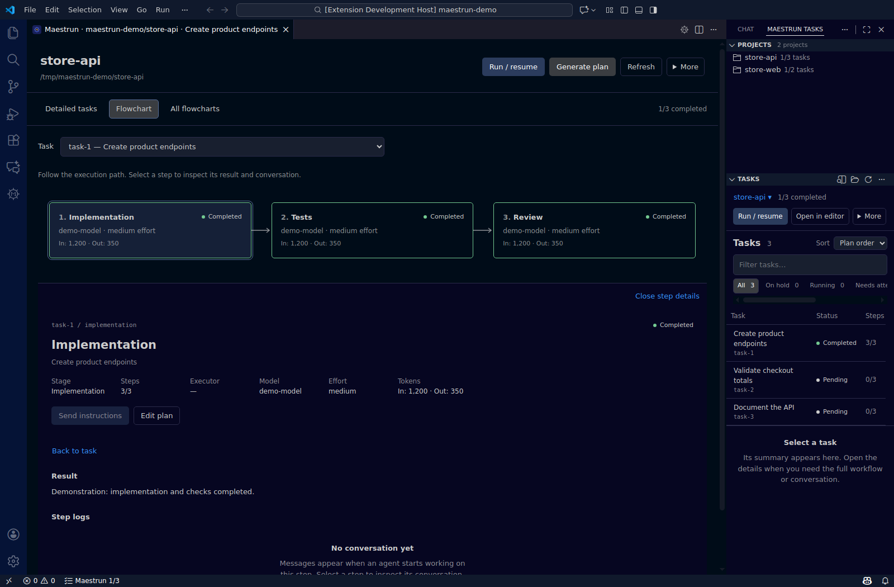
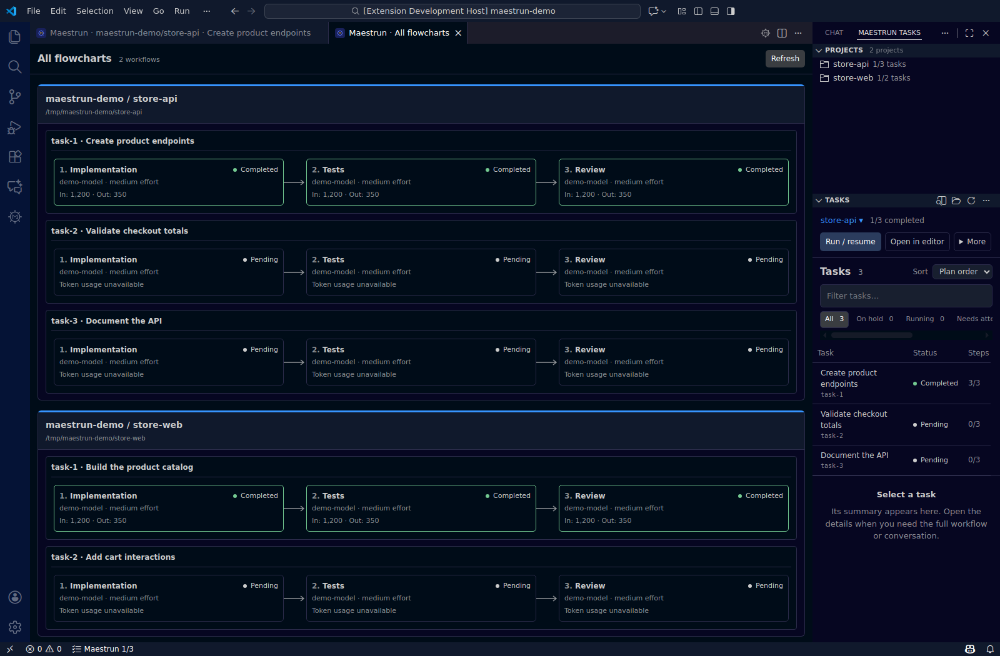

# Maestrun for VS Code

[← Main guide](../README.md) · [Download latest](https://github.com/maestrun/vscode-extension/releases/latest) · [Extension source and releases](https://github.com/maestrun/vscode-extension)

Configure workflows, generate plans, run tasks, and follow their progress inside VS Code. Use the sidebar while editing code, open a full dashboard for task details, or compare projects with flowcharts.

## Install

You need **VS Code 1.106+**, a trusted workspace, **Node.js 24 LTS**, and an [installed and authenticated executor](../README.md#1-install). Use Linux, macOS, WSL, or SSH. On Windows, open your project through WSL. Install Node.js, the CLI, and your executor in the same environment as the project, including when using WSL or SSH.

1. Install the CLI separately. Extension **1.1.0** supports Orchestrator with CLI **0.1.1**; install the latest stable CLI:

   ```sh
   npm install --global @maestrun/maestrun@latest
   ```

2. Download the `.vsix` from the [latest extension release](https://github.com/maestrun/vscode-extension/releases/latest). In VS Code, run **Extensions: Install from VSIX…** and select the file. You can also install the downloaded package from a terminal:

   ```sh
   code --install-extension ./maestrun-vscode-1.1.0.vsix
   ```

3. Open your project folder and click the **Maestrun** Activity Bar icon, or run **Maestrun: Open Maestrun** from the Command Palette (`Ctrl+Shift+P`, or `Cmd+Shift+P` on macOS).

Maestrun is also listed in the [Visual Studio Marketplace](https://marketplace.visualstudio.com/items?itemName=Maestrun.maestrun-vscode). Use the latest GitHub release above for the version described in this guide.

## Choose how to work

| View             | Use it for                                              | How to open it                                                                      |
| ---------------- | ------------------------------------------------------- | ----------------------------------------------------------------------------------- |
| Sidebar          | Follow tasks alongside your code and switch projects    | Click the Maestrun icon; **Projects** and **Tasks** start in the Secondary Side Bar |
| Editor dashboard | Search and filter tasks, inspect results, and read logs | Click **Open in editor**; select a task and choose **View details**                 |
| Task flowchart   | Follow each stage and inspect its output                | Open **Flowchart** and click a stage                                                |
| All flowcharts   | Compare task progress across projects                   | Click **All flowcharts**                                                            |
| Terminal         | Use the guided CLI and its command options              | Follow the [terminal quick start](../README.md#2-start-review-and-run)              |

Run **Maestrun: Choose window position** to change where the views appear. Manual moves are remembered; **Maestrun: Open Maestrun** reopens the panel.

## Set up, plan, and run

1. Open **More → Set up workflow**.
2. Choose your executor, model, and steps, then save the workflow.
3. Click **Generate plan** and enter your requirements or choose a file.
4. Review the tasks. Use **Maestrun: Edit plan** to edit the plan before execution.
5. Click **Run / resume**.

To adjust a workflow, open **Configure workflow → Edit steps and execution in a table**. Set the executor, model, and effort per step, drag rows to reorder them, and save to apply your changes.


Existing projects with `.maestrun/config.json` appear in **Projects**. Select one to follow its tasks or resume unfinished work. The default plan is `plan.md`; see [settings](#settings-and-troubleshooting) if your project uses another file.

**Cancel execution** stops the run and preserves completed work. Closing the dashboard does not stop a background run. Planning and execution use your executor account and consume its usage.

## Orchestrator: coordinate and inspect the whole plan

Choose **Orchestrator** during workflow setup to use an existing `plan.md` or generate one from a prompt file. Review each task’s steps and model assignments before running. Or use the CLI to enable `execution.orchestrator` as `plan` for predefined tasks or `agent` for agent coordination. Both support sequential or parallel execution.

The task table uses a collapsible hierarchy; sorting keeps children with their parents, and filters retain ancestors. **Flowchart** shows each task once after all its prerequisites, including converging branches and coordinated repairs. **Simple** shows tasks; **Detailed** embeds every task’s steps, custom stages and Git integration. **Horizontal** flows left to right; **Vertical** flows top to bottom, including the steps. The view preserves its direction, detail mode and scroll position during updates. Click a task or step to inspect results and conversation. **All flowcharts** uses the same dependency graph for every project.

Task-specific `Steps`, `Parent` grouping and `Agents` file bindings use the [same plan format and model resolution as the terminal](advanced.md#orchestrator-mode). Generated tasks and repair history survive reconnection; navigating the diagram makes no model calls.

## Inspect tasks and respond

Select a task in the sidebar, click **View details**, then open **Flowchart**. Click a stage to inspect its results and logs.



| Task state | What to do                                                                                        |
| ---------- | ------------------------------------------------------------------------------------------------- |
| On hold    | Click **Answer question** and submit your response; use **Run / resume** if execution has stopped |
| Running    | Follow progress or use **Send instructions** when an active model session is available            |
| Failed     | Read the error and open **View execution log** before resuming                                    |
| Completed  | Inspect stage results and continue with the remaining tasks                                       |

For operation errors, the notification's **View logs** action opens the Maestrun output channel.

## Work with multiple projects

Click a project in **Projects** to update the sidebar. Use **Open in editor** to give a project its own dashboard tab, or **All flowcharts** to view tasks grouped by project.



Discovery finds `.maestrun/config.json` in workspace folders and their subfolders, including examples. Click **Refresh** to rescan, or use **Select project → Choose another folder…** for a folder that needs setup.

## Try an example

Run **Maestrun: Run example** from the Command Palette, choose **Simple**, **Advanced**, **Orchestrator plan** or **Orchestrator agent**, then select your executor and model and confirm.

| Example            | What it demonstrates                                                                              |
| ------------------ | ------------------------------------------------------------------------------------------------- |
| Simple             | Two sequential tasks with implementation and tests                                                |
| Advanced           | Five tasks with a pending approval, repair, Git integration, and an intentional failure           |
| Orchestrator plan  | Six predefined tasks, eleven worker stages and nested dependencies                                |
| Orchestrator agent | One objective decomposed into six tasks; targets two coordination calls plus eleven worker stages |

Advanced requires **Git 2.38+**. Answer `continue` when prompted; the run ends **Failed** by design after the remaining work finishes. All examples consume your executor account's usage. See [sample details](advanced.md#sample).

Examples created from the terminal inside the workspace also appear in **Projects**. Click **Refresh** to discover them immediately.

## Settings and troubleshooting

Open VS Code Settings and search for `maestrun`. For WSL or SSH, configure executable paths in the remote environment's settings.

| Setting                   | Default    | When to change it                                                                                                    |
| ------------------------- | ---------- | -------------------------------------------------------------------------------------------------------------------- |
| `maestrun.executable`     | `maestrun` | The CLI is outside PATH; use its executable path or an absolute path to `dist/main.js`, with no arguments            |
| `maestrun.nodeExecutable` | `node`     | Node.js is missing from PATH or the selected version is unsupported; use a supported Node executable                 |
| `maestrun.tasksFile`      | `plan.md`  | Your plan has another path, relative to the selected project folder; **Generate plan** creates and selects `plan.md` |

If the CLI is missing, install it in the project's environment and click **Refresh**. If the panel is hidden, run **Maestrun: Open Maestrun**. The extension requires workspace trust and does not support virtual workspaces.

For reproducible issues, [report a bug in the extension repository](https://github.com/maestrun/vscode-extension/issues) with the extension and CLI versions and the error. Remove secrets from logs before sharing.

_Screenshots show the real extension 1.0.0 interface with demonstration data, reproduced from the [extension's illustrated guide](https://github.com/maestrun/vscode-extension/blob/main/docs/usage.md). No paid model run is shown._
